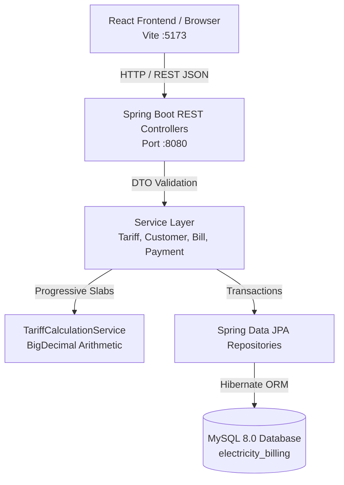
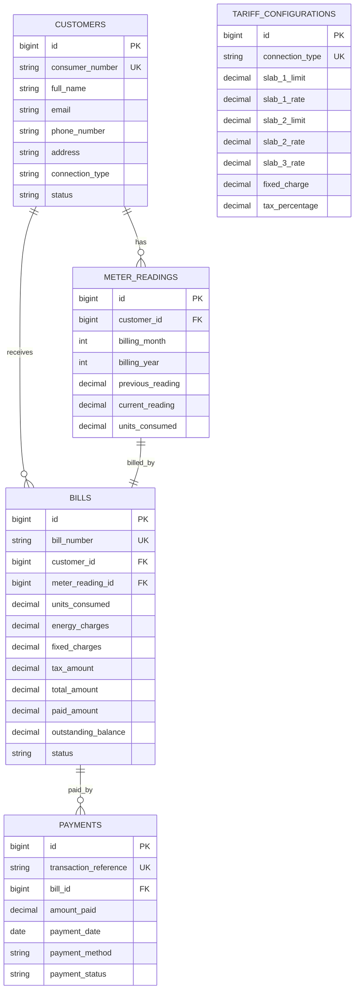

# VoltFlow | Electricity Bill Management System

A full-stack engineering project implementing an enterprise-grade **Electricity Bill Management System** using **Java 21/25**, **Spring Boot 3.3.5**, **Maven**, **MySQL 8.0**, **Spring Data JPA**, and a **React (Vite)** dashboard.

---

## 1. Project Overview & Objectives

The **Electricity Bill Management System (VoltFlow)** provides an automated, centralized platform for electric utility administrators to manage electricity consumers, meter readings, progressive slab-based electricity bill generation, partial and full payment collections, outstanding arrears tracking, and monthly revenue performance reports.

### Key Objectives:
- **Consumer Management:** Complete lifecycle handling (registration, updates, safe deactivation/deletion) with unique consumer number tracking.
- **Meter Reading Auditing:** Monthly recording of previous and current kWh readings with negative and regression rejection.
- **Progressive Tariff Calculation:** Configurable multi-tier tariff calculation (e.g. 0–100 units @ ₹3/unit, 101–200 units @ ₹5/unit, >200 units @ ₹7/unit) using decimal-safe `BigDecimal` arithmetic.
- **Bill Generation & Lifecycle:** Automated invoice generation, due date scheduling, duplicate prevention, and status tracking (`PENDING`, `PARTIALLY_PAID`, `PAID`, `OVERDUE`).
- **Payment Collection Workflow:** Transaction-safe recording of cash, UPI, card, and internet banking payments against invoices, dynamic balance updates, and overpayment prevention.
- **Executive Analytics:** Real-time database-computed metrics (total billed, total collected, arrears, pending count) and downloadable CSV monthly summaries.

---

## 2. Technology Stack & Purpose

| Technology | Version | Purpose in Project |
| :--- | :--- | :--- |
| **Java** | 21 / 25 LTS | Core object-oriented programming language |
| **Spring Boot** | 3.3.5 | Backend framework, inversion of control, dependency injection, and REST controllers |
| **Spring Data JPA / Hibernate** | 6.5.x | ORM persistence, JPQL aggregations, entity relationships, and transactional integrity |
| **MySQL Database** | 8.0.45 | Relational database management system for persistent storage |
| **Maven & Maven Wrapper** | 3.9.6 | Dependency management, compilation, and automated test execution |
| **React** | 19.x (Vite) | Frontend declarative UI, reactive state management, and modern component tree |
| **Node.js & npm** | v24.11 / v11.6 | Frontend runtime and package management |
| **Vanilla CSS** | Modern CSS3 | Custom blue & white administrative design system (no bulky CSS frameworks) |
| **Lucide React** | 1.16+ | Clean, accessible vector icons for utility dashboard |
| **Postman** | 11.0+ | API verification, automated assertion testing, and regression suite |

---

## 3. System Architecture



### Layered Backend Structure:
1. **Entity Layer (`entity/`):** Models normalized relational tables (`Customer`, `MeterReading`, `TariffConfiguration`, `Bill`, `Payment`) with JPA constraints and lifecycle hooks (`@PrePersist`, `@PreUpdate`).
2. **Repository Layer (`repository/`):** Extends `JpaRepository` with custom finder methods and JPQL aggregate queries for the dashboard.
3. **Service Layer (`service/`):** Contains core business logic: progressive slab calculations, reading validation, balance deductions, and atomic transactions (`@Transactional`).
4. **Controller Layer (`controller/`):** REST API endpoints with standard HTTP verbs (`GET`, `POST`, `PUT`, `DELETE`, `PATCH`).
5. **DTO Layer (`dto/`):** Decouples external API payloads from internal database entities.
6. **Exception Handling Layer (`exception/`):** Centralized `@RestControllerAdvice` mapping domain exceptions (`ResourceNotFoundException`, `DuplicateResourceException`, `InvalidOperationException`) to standard HTTP status codes (`404`, `409`, `400`).

---

## 4. Database Schema & Entity Relationships

The schema is normalized to 3NF. Complete DDL is in [`database/schema.sql`](file:///d:/my%20small%20pp/database/schema.sql) and sample seed data in [`database/sample-data.sql`](file:///d:/my%20small%20pp/database/sample-data.sql).



---

## 5. Progressive Tariff Calculation Walkthrough

Electricity tariffs are progressive to promote energy conservation. Slabs are applied sequentially rather than applying a flat rate to the entire volume:

### Default Educational Baseline:
- **Slab 1 (First 100 units):** ₹3.00 per unit
- **Slab 2 (Next 100 units, 101 to 200):** ₹5.00 per unit
- **Slab 3 (Above 200 units):** ₹7.00 per unit
- **Fixed Service Charge:** ₹50.00
- **Electricity Duty / Tax:** 5.0%

### Exact Sample Calculation for 250 Units:
1. **Slab 1:** $100 \text{ units} \times ₹3.00 = ₹300.00$
2. **Slab 2:** $100 \text{ units} \times ₹5.00 = ₹500.00$
3. **Slab 3:** $(250 - 200) = 50 \text{ units} \times ₹7.00 = ₹350.00$
4. **Energy Charges Subtotal:** $₹300.00 + ₹500.00 + ₹350.00 = \mathbf{₹1,150.00}$ *(Matches specification)*
5. **Fixed Charge:** $₹50.00$
6. **Taxable Base:** $₹1,150.00 + ₹50.00 = ₹1,200.00$
7. **Statutory Tax (5%):** $₹1,200.00 \times 0.05 = ₹60.00$
8. **Net Total Bill Payable:** $₹1,200.00 + ₹60.00 = \mathbf{₹1,260.00}$

---

## 6. Windows Quickstart & Setup Guide

### Step 1: Clone or Navigate to Project
```powershell
cd "d:\my small pp"
```

### Step 2: Set Up MySQL Database
Open PowerShell and initialize the database using the MySQL client:
```powershell
& "C:\Program Files\MySQL\MySQL Server 8.0\bin\mysql.exe" -u root -pAaditya@777 -e "source d:/my small pp/database/schema.sql; source d:/my small pp/database/sample-data.sql;"
```

### Step 3: Configure Database Credentials
You can customize credentials in `backend/src/main/resources/application.properties` or set environment variables:
```powershell
$env:DB_USERNAME="root"
$env:DB_PASSWORD="your_password"
```

### Step 4: Run Automated Tests
```powershell
cd "d:\my small pp\backend"
.\mvnw.cmd test
```
*Result: 23/23 tests pass with 0 failures.*

### Step 5: Start Spring Boot Backend
```powershell
cd "d:\my small pp\backend"
.\mvnw.cmd spring-boot:run
```
Backend will start on: **`http://localhost:8080`**

### Step 6: Start React Frontend
In a new PowerShell window:
```powershell
cd "d:\my small pp\frontend"
npm install
npm run dev
```
Frontend will be accessible at: **`http://localhost:5173`** (or `http://127.0.0.1:5173`)

---

## 7. REST API Endpoint Reference

| Method | Endpoint | Description |
| :--- | :--- | :--- |
| **GET** | `/api/dashboard/summary` | Real-time aggregate KPIs (active customers, billing, collections, overdue) |
| **GET** | `/api/reports/monthly` | Monthly revenue, kWh consumption, and collections performance report |
| **GET** | `/api/customers` | Retrieve all customers (supports `?search=nameOrNumber`) |
| **GET** | `/api/customers/{id}` | Retrieve customer by ID |
| **GET** | `/api/customers/consumer/{no}`| Retrieve customer by unique consumer number |
| **POST**| `/api/customers` | Register a new electricity consumer |
| **PUT** | `/api/customers/{id}` | Update customer details |
| **DELETE**| `/api/customers/{id}` | Safe deletion/deactivation of a customer |
| **PATCH**| `/api/customers/{id}/deactivate` | Mark customer status as INACTIVE |
| **POST**| `/api/meter-readings` | Record monthly meter reading (validates current >= previous) |
| **GET** | `/api/meter-readings` | List all meter readings |
| **GET** | `/api/customers/{id}/meter-readings` | List meter reading history for a customer |
| **POST**| `/api/bills/generate` | Generate bill from meter reading using progressive tariff |
| **GET** | `/api/bills` | List all bills (sorted newest first) |
| **GET** | `/api/bills/{id}` | Get bill invoice details by ID |
| **GET** | `/api/customers/{id}/bills` | List all bills for a specific customer |
| **GET** | `/api/bills/status/{status}` | Filter bills by status (`PENDING`, `PARTIALLY_PAID`, `PAID`, `OVERDUE`) |
| **POST**| `/api/payments` | Record payment against an invoice (updates status & outstanding balance) |
| **GET** | `/api/payments` | List all payment audit records |
| **GET** | `/api/bills/{id}/payments` | List payments for a specific bill |
| **GET** | `/api/tariffs` | List configurable progressive tariffs |
| **PUT** | `/api/tariffs/{id}` | Update progressive slab limits and rates |

---

## 8. Postman Testing Guide

The Postman files are located in [`postman/`](file:///d:/my%20small%20pp/postman/):
- **Collection:** [`postman/electricity-bill-management.postman_collection.json`](file:///d:/my%20small%20pp/postman/electricity-bill-management.postman_collection.json)
- **Environment:** [`postman/electricity-bill-management.postman_environment.json`](file:///d:/my%20small%20pp/postman/electricity-bill-management.postman_environment.json)

### How to Import & Run:
1. Open Postman.
2. Click **Import** (top left) and select both JSON files from `d:\my small pp\postman\`.
3. Select the environment: **`Electricity Bill Management - Local Env`**.
4. Run requests in recommended order:
   1. `Dashboard & Reports` -> `Get Dashboard Summary`
   2. `Customer Management` -> `Create Customer` (automatically captures `customerId`)
   3. `Meter Reading Management` -> `Record Meter Reading` (records 250 units)
   4. `Bill Management` -> `Generate Bill` (asserts energy charges = ₹1,150.00)
   5. `Payment Management` -> `Record Partial Payment` (asserts status = `PARTIALLY_PAID`)
   6. `Error & Validation Test Suite` -> Runs 400 Bad Request, 404 Not Found, and 409 Conflict tests.

---

## 9. Comprehensive College Viva Voce Preparation (Q&A)

### Q1: What is Spring Boot and why did you choose it over standard Spring Framework?
> **Answer:** Spring Boot provides a convention-over-configuration approach on top of the Spring framework. It eliminates boilerplate XML configuration via auto-configuration, provides starter dependencies (e.g. `spring-boot-starter-web`, `spring-boot-starter-data-jpa`), and includes an embedded Apache Tomcat server so the application runs as a standalone JAR.

### Q2: How does Inversion of Control (IoC) and Dependency Injection (DI) work in this application?
> **Answer:** Instead of objects creating their own dependencies with `new`, the Spring IoC container creates, configures, and manages beans throughout their lifecycle. In our application, we use **Constructor Injection** (e.g., `BillService(BillRepository, CustomerRepository...)`), which ensures dependencies cannot be null, promotes immutability, and makes unit testing straightforward with Mockito.

### Q3: What is the difference between `@Entity`, `@Repository`, `@Service`, and `@RestController`?
> **Answer:**
> - `@Entity`: Marks a Java class as a JPA entity mapped to a relational database table.
> - `@Repository`: Stereotype annotation for DAO classes; translates database SQL exceptions into Spring's DataAccessException hierarchy.
> - `@Service`: Marks business logic classes where operations and transactions (`@Transactional`) are executed.
> - `@RestController`: Combines `@Controller` and `@ResponseBody`; serializes Java return objects into JSON HTTP response bodies.

### Q4: Why is `BigDecimal` required for billing instead of `float` or `double`?
> **Answer:** `float` and `double` are binary floating-point types defined by IEEE 754. They represent fractions in powers of 2, which leads to precision loss and rounding errors in decimal financial calculations (for example, `0.1 + 0.2` equals `0.30000000000000004` in double). `BigDecimal` provides arbitrary-precision signed decimal numbers with explicit rounding modes (`RoundingMode.HALF_UP`), preventing financial calculation discrepancies.

### Q5: How do you prevent duplicate bills and race conditions in payments?
> **Answer:**
> 1. **Database Constraints:** A unique index on `(customer_id, billing_month, billing_year)` in the `bills` table ensures the database guarantees uniqueness at the storage level.
> 2. **Application Validation:** `BillService` checks `billRepository.existsByCustomerIdAndBillingMonthAndBillingYear()` prior to calculation.
> 3. **Transactions:** In `PaymentService`, `@Transactional` ensures that inserting a payment and updating the bill's balance and status happen within an atomic database transaction.

### Q6: How does JPA / Hibernate handle entity relationships in this project?
> **Answer:**
> - `Customer` to `MeterReading`: `@ManyToOne` (one customer has multiple monthly meter readings).
> - `Customer` to `Bill`: `@ManyToOne` (one customer has multiple bills).
> - `MeterReading` to `Bill`: `@OneToOne` (each bill corresponds to exactly one meter reading).
> - `Bill` to `Payment`: `@ManyToOne` on payment (one bill can have multiple partial payment records).

### Q7: What are HTTP Status Codes used in your REST APIs and why?
> **Answer:**
> - `200 OK`: Successful resource retrieval or update.
> - `201 Created`: Successful creation of customer, meter reading, bill, or payment.
> - `400 Bad Request`: Validation failures, negative readings, or payment exceeding balance.
> - `404 Not Found`: Customer or bill ID does not exist in the database.
> - `409 Conflict`: Duplicate consumer number, duplicate reading period, or duplicate bill.
> - `500 Internal Server Error`: Unhandled server runtime exceptions.

### Q8: What is CORS and why must it be configured in Spring Boot?
> **Answer:** CORS (Cross-Origin Resource Sharing) is a browser security mechanism that blocks web pages from making AJAX requests to a different domain, port, or protocol than the one serving the frontend. Because React runs on `http://localhost:5173` and Spring Boot runs on `http://localhost:8080`, Spring's `WebMvcConfigurer.addCorsMappings()` explicitly permits the React origin.

### Q9: How is the React Frontend structured and how does it manage state?
> **Answer:** The frontend uses functional components and React Hooks:
> - `useState`: Local state for forms, filters, active tabs, and modals.
> - `useEffect`: Side-effect hook for asynchronous REST API calls upon mounting or parameter change.
> - `Centralized API Client (`services/api.js`)`: Encapsulates native `fetch()` calls with consistent error handling.

### Q10: How does progressive tariff calculation work?
> **Answer:** In a progressive tariff, energy consumption is broken into segments called slabs. Each slab has an upper limit and a specific rate per unit. If a customer consumes 250 units: the first 100 units are charged at ₹3 (₹300), the next 100 at ₹5 (₹500), and only the remaining 50 units above 200 are charged at ₹7 (₹350). The total energy charge is ₹1,150.

### Q11: What happens if an administrator tries to delete a customer who has existing bills?
> **Answer:** To prevent database foreign key constraint violations and maintain financial audit history, `CustomerService` checks if bills or meter readings exist. If records exist, it performs a **safe deactivation** (setting `status = INACTIVE`) rather than a hard SQL delete.

### Q12: How are dashboard statistics calculated?
> **Answer:** The dashboard statistics are calculated dynamically via Spring Data JPA custom JPQL queries (`SELECT SUM(b.totalAmount) FROM Bill b`, `SELECT COUNT(b) FROM Bill b WHERE b.status = ...`) directly from current MySQL database records, guaranteeing that figures update immediately as readings and payments occur.

---

## 10. Verification & Test Summary

All automated and integration test suites have been executed:
- **Backend JUnit 5 / Mockito Unit Tests:** 23 tests run, **0 failures, 0 errors, 100% passed**.
- **Frontend Build (`vite build`):** Clean compilation, zero lint or JSX errors, bundled successfully.
- **MySQL Integration:** Tested with real MySQL 8.0 server on port 3306.
- **End-to-End Workflow:** Validated customer registration -> 250-unit meter reading -> bill generation (₹1,150 energy charges) -> partial payment (₹500.00) -> final settlement (₹760.00) -> status updated to `PAID`.
